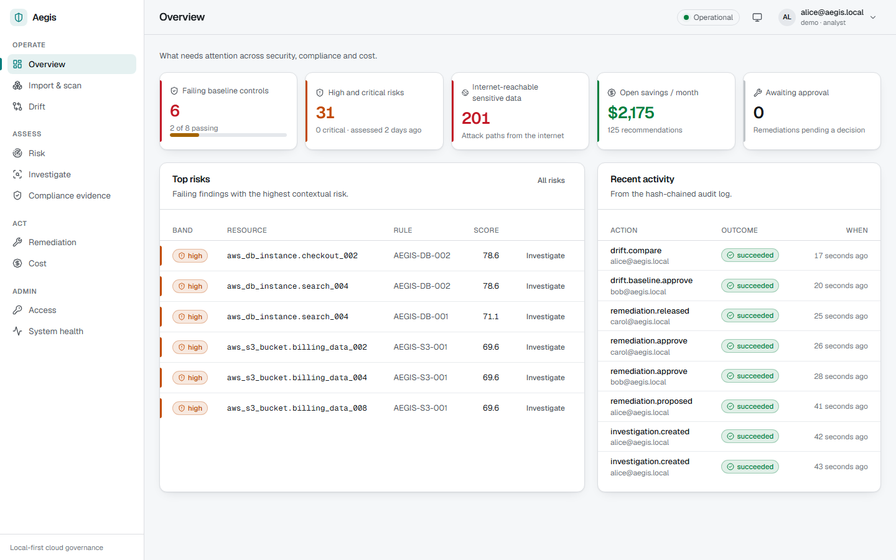
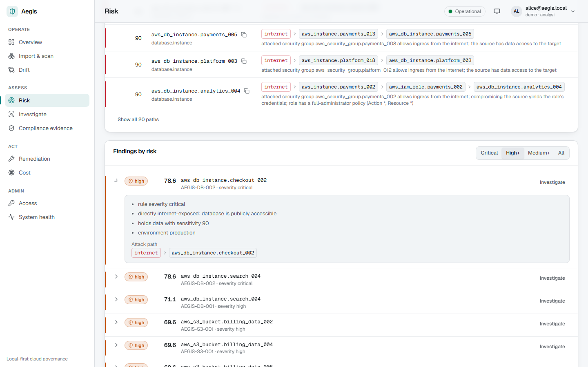
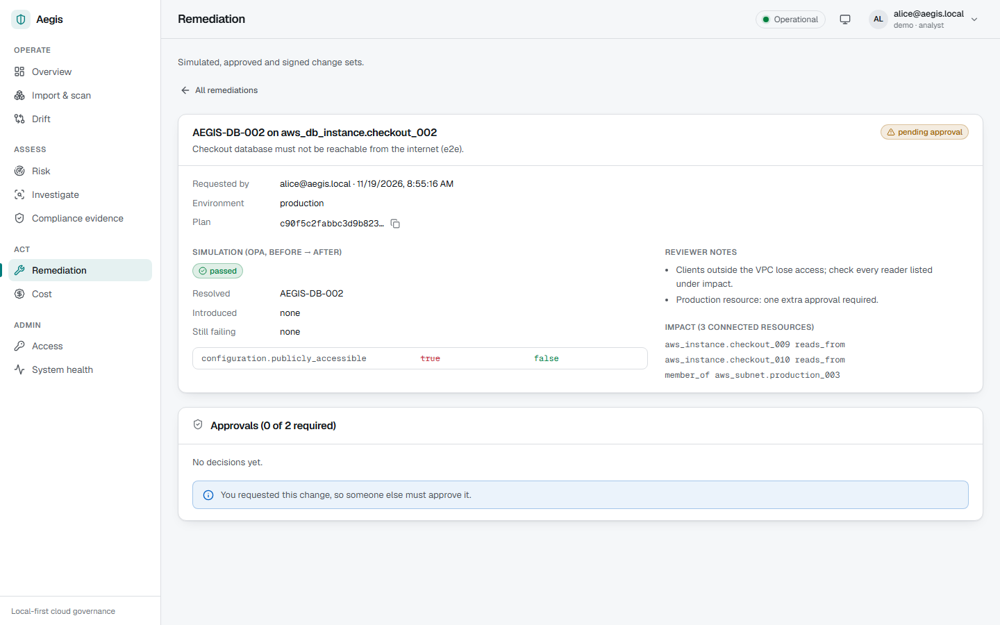
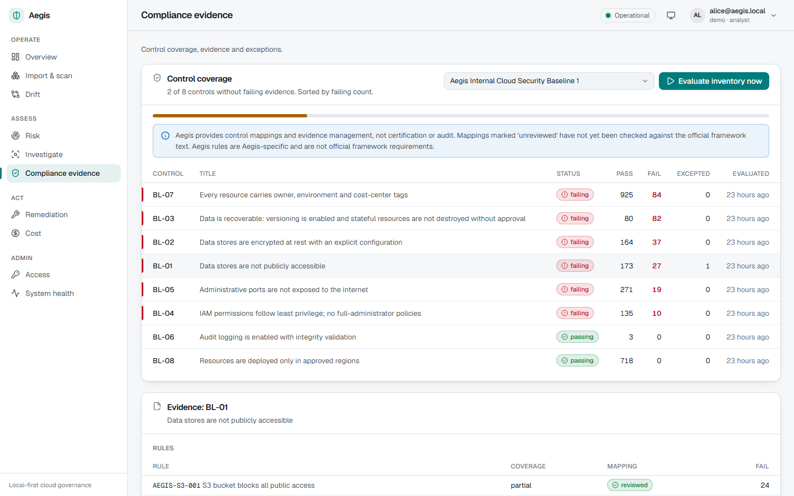
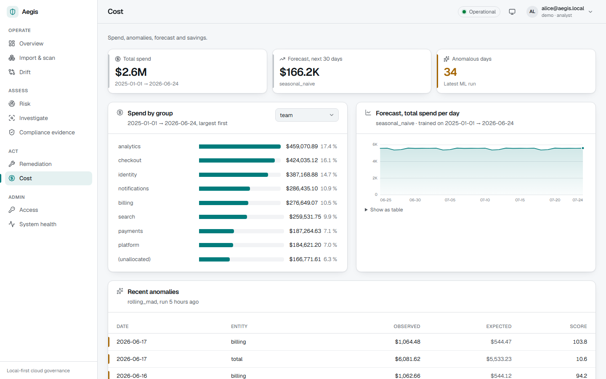

# Aegis

Aegis is a cloud governance platform you can run on your own laptop. It keeps
track of what infrastructure you have, checks Terraform changes before they
are applied, maps problems to compliance controls, ranks them by real risk,
looks at what you spend, and proposes fixes that a human approves. It needs no
paid cloud services and no AI API.



**[Watch the demo (97 s)](https://github.com/manishaacharyahere/aegis-cloud-governance/releases/download/v1.1.0/aegis-demo.webm)** ·
**[Documentation](https://manishaacharyahere.github.io/aegis-cloud-governance/)** ·
**[Evaluation report](docs/research-report.md)** ·
**[All screenshots](screenshots/)**

## Why I built it

Cloud security tools usually do one piece of this well: a scanner here, a
cost dashboard there, a compliance spreadsheet somewhere else. Nobody connects
"this S3 bucket is public" to "it holds billing data, it is reachable from the
internet, it fails CIS 2.1.4, and here is a reviewed change that fixes it".
Aegis is my attempt to build that whole loop properly, with the same care
you would want from a production control plane: tenant isolation, an audit
log you can verify, and no step where an AI gets to change anything on its own.

The rule throughout is **deterministic first, AI second**. OPA policies and
scanners make every decision. The optional local model only explains evidence
that is already collected, and each of its claims is checked against that
evidence before you see it.

## What it does

- **Inventory.** Point the read-only collector at a real AWS account
  ([how, free](docs/aws-collector.md)), or import a snapshot or a Terraform state file.
  Aegis normalises resource types, strips secrets before anything is stored,
  ignores re-sent snapshots, and keeps a version history of every resource.
- **Terraform checks.** Each plan runs in a locked-down container with no
  network, no capabilities and a read-only filesystem. Aegis evaluates it with
  its own OPA rules and also runs Trivy and Checkov, then merges the results
  into one report.
- **Compliance.** Findings map to NIST CSF 2.0, CIS AWS 3.0.0 and an internal
  baseline. Exceptions expire and need a second person to approve them. Every
  evaluation records the exact policy text and snapshot it used, so you can
  reproduce it later.
- **Drift.** Approve a baseline, then see what changed since: configuration,
  tags, relationships, new and deleted resources. Each change is rated by the
  policy failures it introduces.
- **Risk.** A six-factor score explains why a finding matters (exposure, data
  sensitivity, environment and so on). Attack paths show how something
  reachable from the internet leads to sensitive data.
- **Cost.** Import billing data and see spend by team or service. Aegis
  suggests savings (idle and oversized resources) and checks them against what
  you actually saved later. A Python worker finds anomalies and forecasts
  spend.
- **Investigation.** Ask about a resource and get a brief where every
  sentence cites its evidence. A local model (Ollama) can be switched on; it
  has no tools and cannot act.
- **Remediation.** Propose a fix and Aegis simulates it against the same
  policies, so you see what it resolves and whether it breaks anything else.
  Production changes need two approvers, and the requester never counts as
  one. The approved change set is signed and handed to your pipeline; Aegis
  never touches cloud resources itself. After the next import it checks that
  the fix really landed.

<table>
<tr>
<td></td>
<td></td>
</tr>
<tr>
<td></td>
<td></td>
</tr>
</table>

## How it is built

One Go codebase runs the API and control plane, a separate worker runs the
Terraform scans, and a Python worker handles the ML. I chose a modular
monolith over microservices on purpose
([ADR-007](architecture/architecture-decisions/ADR-007-modular-monolith.md)):
one team does not need a network between its modules.

```
React dashboard ──► Go API ──► PostgreSQL (system of record, hash-chained audit log)
                      │  │
                      │  └──► outbox ──► NATS JetStream ──► re-evaluation after imports
                      ├──► OPA (every policy decision)
                      └──► IaC queue ──► aegis-worker (Terraform, Trivy, Checkov in sandboxed containers)
Python ML worker (anomalies, forecasts) · Dex for sign-in · Prometheus, Grafana, Jaeger
```

A few things I cared about:

- **Separation of duties is enforced in the database transaction**, not just
  in the UI. The API itself cannot delete or rewrite evidence: its database
  role has no such rights, and old evidence is removed only through a database
  function that enforces minimum retention.
- **The audit log is a hash chain.** You can verify it, and anchor its head
  outside Aegis to prove nothing was rewritten later.
- **Writes are safe to retry.** Every `POST` accepts an `Idempotency-Key`,
  events go through a transactional outbox, and a broker outage delays events
  without losing them.
- **The API is described by an OpenAPI contract.** The dashboard's types are
  generated from it, and a test fails if a route is missing from it.

**Stack:** Go · PostgreSQL · OPA/Rego · NATS JetStream · React 19 + TypeScript
+ Tailwind · Python (statsmodels, scikit-learn) · Terraform, Trivy, Checkov ·
OpenTelemetry · Docker Compose

## How it was tested

The numbers below come from seeded synthetic data on one laptop. The
[evaluation report](docs/research-report.md) says what they do and do not
show.

- The IaC checks match the ground truth on all 6 Terraform fixtures.
- The inventory evaluation found all 132 seeded violations with no false
  positives.
- The remediation loop fixed 121 synthetic findings, verified every one, and
  introduced no new failures.
- Seeded drift was detected exactly over 200 random seeds.
- Risk rankings stayed stable when each weight moved by ±20 %.
- For cost forecasting, a plain seasonal-naive baseline beat Holt-Winters and
  SARIMAX on this data, so it is the default.
- The full pipeline was measured at 100 to 10 000 resources, with the database,
  OPA, NATS and the identity provider failing mid-run
  ([performance](docs/performance.md)).

Every push runs the Go unit and integration tests against real PostgreSQL,
OPA, NATS and an AWS emulator (81.7 % statement coverage combined), 34 OPA policy
tests, the web unit tests, the Python tests, type and lint checks, the
OpenAPI contract check and a secret scan. Seven browser journeys run against
the real stack with real sign-in (see [apps/web/e2e](apps/web/e2e/README.md)).

The whole codebase has also been through two rounds of adversarial review.
Several specialist reviewers looked for bugs, races, security holes and
design problems, and separate verifiers checked each claim against the code
before anything was changed. Fixes shipped with tests that fail without them.

## Run it

You need Docker, Go 1.27 and Node 24.

```bash
cp .env.example .env                       # set the passwords
docker compose --profile core up -d --build
curl http://127.0.0.1:8080/readyz          # {"checks":{"database":"ok"},"status":"ready"}

cd apps/web && npm ci && npm run dev       # http://127.0.0.1:5173
```

To sign in with real accounts, run the scanner, or load the demo data, follow
[docs/getting-started.md](docs/getting-started.md).

To run it in the cloud, use the Helm chart in `deploy/helm/aegis`. It works
on any Kubernetes cluster (EKS, GKE, AKS, k3s), and CI installs it on a fresh
cluster on every push. [docs/deploy.md](docs/deploy.md) also has a step-by-step
free route: an Oracle Cloud Always Free VM, k3s, Let's Encrypt and sign-in
with GitHub.

## Where things are

| Path | What is there |
|---|---|
| `cmd/` | `aegis-api`, `aegis-worker` (IaC scans), `aegis-collect` (reads a real AWS account), `aegis-datagen` (synthetic data), `aegis-verify` (checks signed change sets) |
| `deploy/helm/aegis` | The Helm chart for running it on Kubernetes |
| `services/` | One package per module: inventory, iac, compliance, drift, risk, finops, investigator, remediation, plus access, audit, outbox, automation, retention, tenancy and the HTTP API |
| `packages/` | Shared Go code: config, database, logging, telemetry, OPA client, NATS, redaction, signing |
| `migrations/` | SQL migrations, embedded in the binary and applied by a one-shot job |
| `policies/` | Rego policies and their tests |
| `apps/web/` | The React dashboard, built on one shared component library ([docs/ui.md](docs/ui.md)) |
| `ml/` | The Python FinOps package and worker |
| `datasets/` | Seeded synthetic data and Terraform fixtures with ground truth |
| `tests/integration/` | Tests against real PostgreSQL, OPA and NATS |
| `architecture/`, `security/`, `docs/` | Decisions (ADRs), the threat model, and the user and developer docs |

## Security

Please report vulnerabilities as described in [SECURITY.md](SECURITY.md). The
threat model is in [security/threat-model.md](security/threat-model.md).

## License

[MIT](LICENSE)
