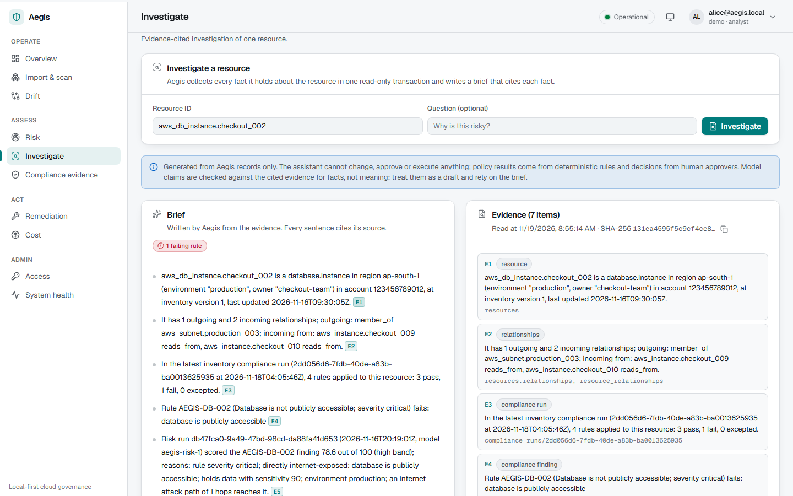

# Aegis

**Aegis** is a local-first cloud governance, security, compliance, risk and
FinOps platform. It turns an AWS-like inventory and Terraform plans into
policy findings, drift, contextual risk and cost insight, then closes the loop
with approval-gated remediation.

Its rule is **deterministic before AI**:

- OPA decides policy;
- explainable formulas score risk;
- humans approve changes, after a simulation shows what they will do;
- an optional local language model may explain evidence, and every one of its claims is checked.

## Start here

- [Getting started](getting-started.md): run the stack locally with Docker Compose.
- [Evaluation report](research-report.md): every measured result, its method, and what it does not prove.
- [Screenshots](https://github.com/manishaacharyahere/aegis-cloud-governance/tree/main/screenshots) of the five user journeys.

## Modules

| Module | What it does |
|---|---|
| [A. Inventory](modules/inventory.md) | Validated, redacted, idempotent snapshot import with version history |
| [B. IaC scanning](modules/iac.md) | Sandboxed Terraform plans, Trivy, Checkov and Aegis OPA rules, run on a durable job queue |
| [C. Compliance](modules/compliance.md) | NIST CSF 2.0, CIS AWS 3.0.0 and an internal baseline: evidence, coverage, expiring exceptions |
| [D. Drift](modules/drift.md) | Approved baselines vs observed state, with policy-aware severity |
| [E. Risk](modules/risk.md) | Six-factor contextual score and attack paths from the internet to sensitive data |
| [F. FinOps](modules/finops.md) | Cost allocation, anomalies, forecasts and recommendations with measured savings |
| [G. Investigation assistant](modules/investigator.md) | Cited, read-only evidence briefs; optional local model with claim validation |
| [H. Controlled remediation](modules/remediation.md) | Simulated, pinned, two-person-approved change sets; Aegis never touches the cloud |

## Platform

- [Authentication and RBAC](auth.md): OIDC tokens and per-tenant roles.
- [Domain events](events.md): transactional outbox relayed to NATS JetStream.
- [Observability](observability.md): OpenTelemetry, Prometheus, Grafana and Jaeger.
- [Scale and resilience](performance.md): 100 to 10 000 resources, and fault injection.

## Design records

Architecture decisions and the threat model live in the repository:
[ADRs](https://github.com/manishaacharyahere/aegis-cloud-governance/tree/main/architecture/architecture-decisions) ·
[threat model](https://github.com/manishaacharyahere/aegis-cloud-governance/blob/main/security/threat-model.md).
